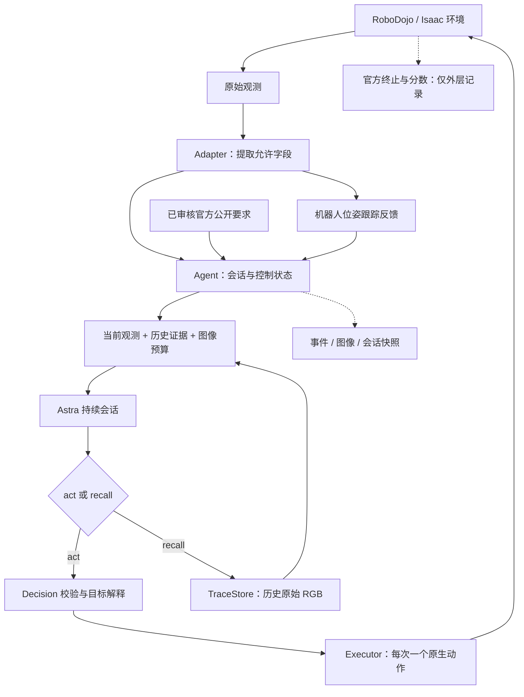
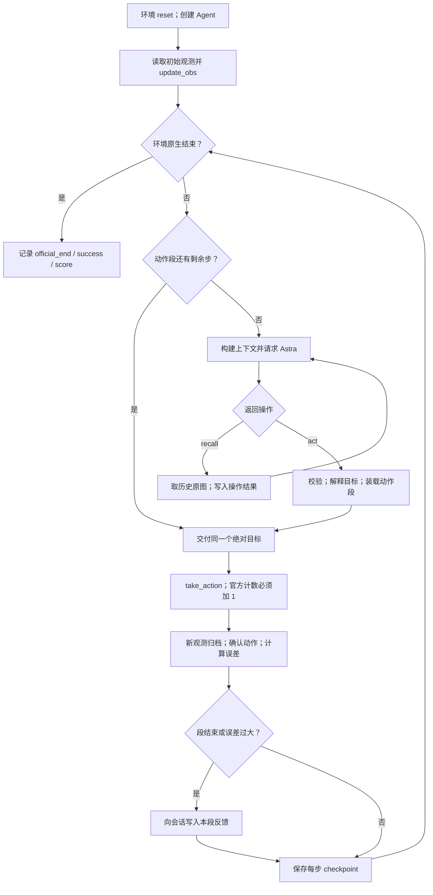
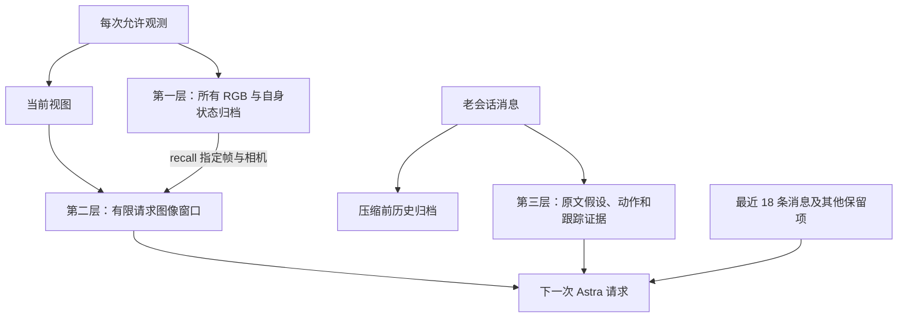
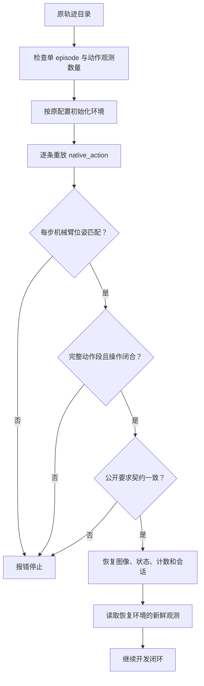

# Astra × RoboDojo Harness：从观测到执行、记忆与恢复

> 核查日期：2026-09-12。源码快照：`85166ac11c0b6a2ba4d073adacd5df39a78ceaf6`。
> 本文解释实际实现，不是新实验报告。文档编写期间没有启动模拟器、调用 Astra 或修改控制代码。

## 1. 框架负责什么

这个 harness 连接 RoboDojo 机器人环境和 Astra 多模态决策会话。每个 episode 使用一个持续存在的 Agent、一份会话历史，由同一个模型共同控制左右 ARX X5 机械臂。

一次闭环是：**环境提供 RGB 和自身机器人状态 → harness 过滤、整理并保存观测 → Astra 决定动作或召回历史图像 → harness 翻译为末端绝对目标 → 环境执行 → harness 计算实际跟踪反馈 → 模型根据新证据继续。**

| 层次 | 职责 | 边界 |
| --- | --- | --- |
| RoboDojo / Isaac | 场景、物理、IK 与控制器、动作计数、原生终止、官方评分 | 评分器内部可用的真值不会因此成为模型输入 |
| Harness | 输入过滤、公开任务要求补充、会话、动作解释、执行顺序、反馈、记忆、日志与恢复 | 不替模型规划抓取、执行任务宏或自动复位 |
| Astra | 理解图像、选择双臂动作和持续步数、召回历史、更新假设 | 模型说成功不能替代官方判定，也不能直接结束 episode |

框架没有训练中的 VLA、自动物体跟踪器或独立抓取检测器。动作决策由 Astra 产生，harness 提供可验证的接口与证据。



评分分支没有返回模型输入。公开要求描述“应该完成什么”；在线评分真值描述“现在完成了多少”，两者不可混用。

## 2. 源码地图

| 文件 | 主要职责 |
| --- | --- |
| [agent.py](../src/dojo_astra/agent.py) | 总控制器、系统提示、act/recall、观测接收与动作调度 |
| [observation_adapter.py](../src/dojo_astra/observation_adapter.py) | 输入白名单、形状与数值检查 |
| [public_instructions.py](../src/dojo_astra/public_instructions.py) | 精确匹配短 instruction，补充审核过的公开要求 |
| [azure_session.py](../src/dojo_astra/azure_session.py) | Azure 客户端、协议、重试、会话状态 |
| [arx_x5_interpreter.py](../src/dojo_astra/arx_x5_interpreter.py) | 动作 schema、坐标变换与绝对目标生成 |
| [executor.py](../src/dojo_astra/executor.py) | 动作段执行、观测确认、位姿误差与反馈 |
| [visual_context.py](../src/dojo_astra/visual_context.py) | 请求图像预算与当前视图保护 |
| [evidence_context.py](../src/dojo_astra/evidence_context.py) | 老文本历史整理为证据账本 |
| [trace_store.py](../src/dojo_astra/trace_store.py) | RGB、事件、会话快照、压缩前历史归档 |
| [process_policy.py](../src/dojo_astra/process_policy.py) | 模拟器与策略子进程的 JSON 行协议 |
| [deploy.py](../src/dojo_astra/deploy.py) | XPolicyLab 的 Model 和单环境入口 |
| [recovery.py](../src/dojo_astra/recovery.py) | 开发轨迹动作重放与会话恢复 |
| [episode_validation.py](../src/dojo_astra/episode_validation.py) | 结果、动作、观测、响应和图像一致性检查 |
| [run_episode_loop.py](../scripts/run_episode_loop.py) | 开发闭环、每步 checkpoint、最终结果 |
| [policy_process.py](../scripts/policy_process.py) | 持久策略子进程入口 |
| [smoke_sim.py](../scripts/smoke_sim.py) | 初始化开发环境与官方判定，启动闭环 |
| [run_worker_episode.sh](../scripts/run_worker_episode.sh) | Worker 预检、解释器、路径与验证串联 |
| [summarize_episode.py](../scripts/summarize_episode.py) | 已有轨迹离线统计 |

## 3. 两个入口，共用一个 Agent

### 3.1 部署路径

`deploy.Model` 明确要求 `action_type=ee`、`env_cfg_type=arx_x5`，对外提供 `reset()`、`update_obs(obs)`、`get_action()`。动作返回长度为 1 的列表，支持单环境，不是批量多环境策略。

`eval_one_episode()` 在环境未结束时循环：`update_obs → get_action → take_action`。注意，若最后一个 take_action 使环境结束，下一轮直接退出，**这个部署示例不会再补发终止后的观测**。因此它和开发循环在最后反馈、日志完整性及恢复条件上不完全相同。

### 3.2 开发路径

```text
run_worker_episode.sh
  ├─ worker_preflight.py
  └─ smoke_sim.py                     Isaac / RoboDojo 解释器
       └─ run_episode_loop.py
            └─ ProcessPolicy
                 └─ policy_process.py    Astra API 解释器
                      └─ Agent
```

两个 uv 环境隔离 Isaac 与 API 依赖。策略子进程在整个 episode 常驻，不是每步重新启动 Python 或开启全新会话。

ProcessPolicy 经 stdin/stdout 交换一行一个 JSON，请求带递增 id。返回序号不匹配、子进程断开、非法操作都会失败。stderr 单独写入 policy.log，防止普通日志污染协议。

smoke_sim 创建一个环境、设置 seed 并取一个可用评测布局；在首个动作前注册官方 `run_reward()` 和可选的 `get_score()`。这些检查只服务外层评分。该入口标记 `development_only`，不代表完整官方任务、布局和种子分布。

### 3.3 reset 初始化什么

Agent.reset 创建新的 episode UUID、TraceStore、会话与 Executor，清空待处理操作、目标、计数、初始位姿和公开要求契约。

这是策略状态初始化；场景和机器人物理复位由环境完成。任务结束要求“回到初始位姿”时，模型仍须自己生成返回动作，不能调用这个 reset 来完成任务。

## 4. 从首帧到结束：完整闭环

下图以开发路径为准，它会在每个环境动作后立即获取观测。



### 4.1 update_obs 的顺序

1. 使用本地 sequence 调用 adapt，得到过滤后的观测。
2. 首帧确定 instruction 和公开要求契约；后续指令若改变，立即报错。
3. 首帧保存双臂 initial_poses。
4. 归档 RGB 和允许的机器人状态。
5. Executor 接收观测；若上次发出动作，确认动作并计算跟踪反馈。
6. 只有确认了自己请求的动作，own executed steps 才加 1。
7. 若动作段结束，将反馈作为模型操作结果写回，清除 pending_call。
8. 本地观测 sequence 加 1。

**观测序号、环境步数、模型响应数是三种计数。** 多取一帧不一定执行一步；recall 增加模型响应数但不产生环境动作。

### 4.2 get_action 的顺序

没有观测，或上一动作仍等观测确认时，get_action 拒绝执行。若动作段尚有剩余步，直接返回下一个原生动作，不请求 Astra。

段结束才整理当前 summary 和图像，请求模型。模型可以连续 recall，再提交 act；act 校验后生成固定目标、装载 Executor，最后返回一个原生动作并记录 native_action。

native_action 记录的是“已交付给外层的动作”，不能单凭它证明环境执行完成；下一观测和外层官方计数检查才提供确认。

### 4.3 动作段内部有没有观察

有。开发循环每次 take_action 后都读图、保存并计算误差，但通常不重新询问模型。模型在段边界得到反馈后再规划。

因此 steps=8 表示最多连续 8 次原生调用后再决策：中间有观测和大误差中断检查，没有逐步模型重规划。

## 5. 输入边界：模型知道哪些信息

### 5.1 允许字段与检查

| 原始输入 | 校验与语义 |
| --- | --- |
| data_format_version | 必须是 v1.0 |
| instruction | 非空字符串 |
| 左右臂 ee_pose | 7 个有限数 `[x,y,z,qw,qx,qy,qz]`，四元数模长检查 |
| 左右臂 ee_joint_state | 长度 1、范围 [0,1]，作为夹爪命令回显 |
| vision 中各相机 color | 至少一个相机；每张为 H×W×3 的 uint8 RGB |

原始 reward、success、物体真值位姿、深度、分割、相机标定、原始 action 和其他 metadata 不会复制进 Observation。进程路径先过滤再做 PNG/base64 序列化，策略进程解码后 Agent 再次适配。

相机这里是字段白名单，不是硬编码相机名称白名单：adapter 遍历上游 vision 中所有 color。当前配置是头部和两腕视图，但代码没有固定只接受三个相机；相机来源仍依赖上游官方配置正确。

### 5.2 决策 summary

每次新决策包含原始 instruction、当前帧号、双臂当前与初始位姿、tool_axes_world、gripper_command_echo、上一段反馈和可召回帧范围。开关启用时还包含自身已确认环境步数和 evidence_check；匹配到公开要求时加入 public_task_requirements。

tool_axes_world 由观测四元数直接计算，只是自身状态的另一种表达，没有引入相机外参、物体位置或接触真值。

夹爪回显尤其容易误读：close=0 只能说明给出了关闭命令，不是测得夹紧、不是真实指间宽度，更不是抓取成功信号。

### 5.3 公开要求补齐 instruction 信息缺口

public_instructions 精确匹配完整短指令，在独立字段补充已审核的静态公开要求，保留原始 instruction。它不模糊推断任务、不在线查询评分器来提供当前进度。

版本是 `robodojo-public-2026-09-12-v1`，覆盖五个任务：

| 任务 | 补充要求摘要 |
| --- | --- |
| [Align Blocks](https://robodojo-benchmark.com/doc/sim-tasks/align-blocks/) | 用三角尺推成直且平行的行；全程块留在桌面；最后复位 |
| [Stack Blocks](https://robodojo-benchmark.com/doc/sim-tasks/stack-blocks/) | 三块稳定、已释放的堆叠；最后复位 |
| [Deposit Coin](https://robodojo-benchmark.com/doc/sim-tasks/deposit-coin/) | 币完整插入槽中；最后复位 |
| [Fill Egg Holder](https://robodojo-benchmark.com/doc/sim-tasks/fill-egg-holder/) | 逐个转移、正确放置并释放四枚蛋；完全正确合盖；最后复位 |
| [Cover Blocks](https://robodojo-benchmark.com/doc/sim-tasks/cover-blocks/) | 从左到右全部盖住，再按红绿蓝揭开且后续颜色保持覆盖；杯姿态有效；最后复位 |

消息含版本、来源 URL、要求和静态范围声明；首帧事件还记录来源 HTML SHA256。核查详情见 [公开指令审计](public-instruction-audit.md)。

未知 instruction 不补要求，不能给未列入的 General Pickup、Xylophone 等统一添加复位规则。需要复位的任务使用双臂 episode 初始末端位姿，不是关节角；释放、避让和返回仍由模型规划，不提供奖励容差或自动回原点操作。

## 6. 动作接口：单位、坐标系和 steps

### 6.1 act 的结构

每个 act 必须包含 left、right、steps、note。steps 为 1～8 的严格整数；note 最多 2000 字符。多余字段、非法枚举、非有限数和超范围幅度会被拒绝。

| 每臂字段 | 含义 |
| --- | --- |
| operation | hold / translate / rotate |
| frame | world / tool |
| axis | +x、-x、+y、-y、+z、-z |
| amount | hold 必须 0；平移为 (0,30] mm；旋转为 (0,15] 度 |
| gripper | hold / open / close |

示例仅解释协议：

```json
{
  "name": "act",
  "arguments": {
    "left": {"operation": "translate", "frame": "world", "axis": "+z", "amount": 10, "gripper": "hold"},
    "right": {"operation": "hold", "frame": "world", "axis": "+z", "amount": 0, "gripper": "hold"},
    "steps": 3,
    "note": "示例：左臂向上调整，随后查看前后图像；不据此声称抓取成功。"
  }
}
```

hold 仍须满足完整 schema，但 frame 和 axis 不会改变保持目标。gripper open 转成 1，close 转成 0，hold 沿用最近允许观测的命令回显。

### 6.2 坐标转换

设段开始观测位置为 p、旋转矩阵为 R，有符号单位轴为 a。

```text
世界系平移：p_target = p + a × amount / 1000
工具系平移：p_target = p + R a × amount / 1000
世界系旋转：R_target = ΔR × R
工具系旋转：R_target = R × ΔR
```

旋转采用右手定则，四元数是 scalar-first，即 qw,qx,qy,qz。world 是环境局部世界系，z 向上，不是机器人基座或相机坐标；tool 是被观测末端 link6 的局部朝向。

tool_axes_world 提供 R 的三列，表示 link6 的 +x/+y/+z 在世界中的方向。它不是校准后的抓取 TCP，也不保证 tool +z 指向夹爪外侧。

旋转保持 link6 位置不变，指尖仍可能扫过圆弧。“末端位置不变”不等于“指尖世界位置不变”。

### 6.3 重复同一绝对目标

若上例初始 z=0.400 m，Interpreter 一次计算 z=0.410 m。3 次原生调用都发 0.410，不会变为 0.410、0.420、0.430。右臂 hold 也固定为段开始观测的位姿，中途不重新解释增量。

最终生成 left_ee_pose、right_ee_pose 两个长度 7 数组，以及左右 ee_joint_state 两个长度 1 数组。实际 IK、跟踪控制与物理交互交给环境。

## 7. Executor：确认执行与跟踪反馈

Executor 保存段开始观测、固定目标、remaining、本段已执行次数和 pending。next_action 交付一次动作，remaining 减 1、pending 设为 true；必须收到更新观测才解除 pending。当前段没有结束时不能替换目标。

每次确认计算左右臂的欧氏位置误差 mm、相对四元数角误差、相对段起点累计位移，以及 before/after 帧号。

| 判定 | 当前规则 |
| --- | --- |
| pose_reached | 两臂位置误差均 ≤2 mm，角误差均 ≤2° |
| interrupted | 任一臂位置误差 >60 mm 或角误差 >30° |
| 正常结束 | 选定 steps 已全部交付并确认 |
| 提前结束 | 上述大误差触发中断 |

这些是 harness 自身机器人跟踪阈值，不是任务奖励阈值。**pose_reached 本身不会提前结束动作段**，未发生大误差时仍执行完 steps。

基础反馈包含 steps、pose_reached、interrupted、remaining_steps、error_mm、error_deg、displacement_mm、before、after，以及始终不确认任务语义的 semantic_status=unconfirmed。

详细模式额外给出目标和观测位姿、剩余原生调用数、连续已结束但未到位的段数，并声明证据只涉及机器人跟踪，接触与物体状态未知。未到位计数不自动触发退让策略。

每个原生步更新内存反馈，但给模型写 operation_result 和正式 feedback 事件通常在段结束时。如果环境在段中途结束，开发结果仍可保存最后图像和 last_feedback，但模型操作可能尚未闭合，因而不满足恢复条件。

## 8. API 协议、900 秒 timeout 和重试

### 8.1 两种会话协议

| 项目 | tools | json-high |
| --- | --- | --- |
| 类 | ChatSession | JsonSession |
| 输出 | 原生 function tool call | JSON 的 name + arguments |
| schema 位置 | API tools 参数 | 系统消息 |
| reasoning_effort | none | high |
| max_tokens | 4096 | 8192 |
| 输出约束 | 恰好一个完成的 tool call | 完整合法的单个操作对象 |
| 本文恢复路径 | 不支持 | 支持受限边界恢复 |

没有静默协议降级。截断、非法 JSON 或错误动作直接失败，不改成默认 hold。JsonSession 用 pending ID 强制每个操作有且只有一个匹配结果；未完成前不能请求下一决策，重复或过期结果会报错。recall 也遵守这套顺序。

客户端从外部示例文件 AST 中读取 AzureOpenAI 字面量配置，不执行示例文件；凭据不属于文档内容或策略提示。

### 8.2 重试的是 API，不是机器人动作

SDK 自带 max_retries=0，由 complete 统一重试。客户端和每次 API 请求均设置 timeout=900 秒。最多 6 次尝试，即首次加 5 次重试。

连接错误、超时以及 HTTP 408、409、429、5xx 可重试，间隔为 2、4、8、16、30 秒。其他错误或最后一次失败直接抛出；重试事件记录错误类别、状态码和等待时间。

900 秒是单次请求的 SDK timeout 配置，不是 episode 墙钟上限，也不应理解成所有网络阶段合计时长的精确硬截止。

等待期间没有执行机器人动作，因此不会因 API 重试重复 take_action；但不能保证服务端未处理过此前超时请求，也不保证避免重复计费。

session.calls 在收到响应时加 1，包括 recall 和之后可能解析失败的响应；失败的 HTTP 尝试不计入该数。

### 8.3 各类预算

| 项目 | 当前完整 episode 开发路径 |
| --- | --- |
| 总环境步数 | harness 不设上限，遵循 RoboDojo 原生终止 |
| 模型响应次数 | 不设上限 |
| 策略进程单次等待 | runner 显式 timeout=None |
| 单次 Astra timeout | 900 秒，另有有限重试 |
| 每段原生调用数 | 模型选 1～8 |
| 单请求图像数 | 默认 6 张 |
| 单响应输出 tokens | 按协议限制 |

库中 Agent 仍提供可选 max_calls，通用 ProcessPolicy 默认 timeout 仍为 180 秒，旧 calibration 子路径也保留 180 秒子进程等待。当前 runner 显式关闭外层步数、响应数和进程等待限制，不意味着所有入口自动配置一致。

## 9. 三层记忆：全量原图、有限图像窗口、文本账本



### 9.1 全量原图档案与 recall

每次观测各相机的 RGB 保存为 PNG，并记录对应自身状态。图像被移出在线请求后仍可从磁盘召回：

```json
{"name":"recall","arguments":{"sequence":12,"camera":"实际归档中的相机名"}}
```

必须使用存在的帧号和相机名。Agent 读取原图，作为 data URI 重新发送；pin_current 开启时附上该历史帧机器人状态，避免把历史图和当前姿态混用。

这是按键取原图，不是语义检索，没有自动关键帧选择、裁剪、分割或图像对比引擎。由模型选择要看什么。

### 9.2 6 张预算保护什么

trim_images 统计整份 messages 中真实 image 内容，先保留受保护当前图像，再保留其他图像中最新的若干张。当前三相机、预算 6 且 pin_current 开启时，通常是当前 3 张 + 最近历史 3 张。

名额按图像，不按完整帧组分配；recall 可以占用历史位置，不保证永远保留上一帧完整三视图。被移除图像变成说明文字，其帧号标签即使仍存在，也不表示模型这次能看见原像素。

当前图像按内容对象身份保护。受保护数量大于预算会失败，不静默牺牲当前视图。关闭保护时只按新旧裁剪，连续 recall 可能把当前图像挤出去。

所以 6 张不等于 6 回合，也不是 6 组相机；这里没有缩放分辨率来省预算。

### 9.3 文本压缩不把假设变成事实

evidence 模式在下一次请求前调用 compact_history，默认保留最近 18 条消息，不是 18 个决策回合；系统消息和仍含图像的部分旧消息也保留。

较老消息抽取为 evidence_ledger：模型 note 原文标记 model_note_verbatim_unverified，保留左右动作和 steps，并记录 before/after、pose_reached、interrupted、位置与角误差等测量字段。

这是确定性的字段整理，不是另一次模型摘要。旧 note 不被提升为已验证结论；提示要求模型识别后续证据是否推翻过去判断。

压缩不是无损在线历史：部分老观测描述、详细反馈和其他文本被移除。压缩前完整 messages 会追加到 context-archive.jsonl，供离线审计。

**账本会随动作段增长，没有固定总 token 上限。** 视觉预算和消息压缩降低负担，但不能保证任意长 episode 都不会超上下文。重复归档含图像 data URI 的会话也会增加磁盘占用。

## 10. 原生终止与官方评分

run_episode_loop 拒绝非 None 的 max_steps/max_calls，CLI 要求两个参数为 0，转换为内部 None。超过历史上的 200 步也不会被 harness 截断。正常结束取决于 env.is_episode_end。

每步要求官方动作计数恰好加 1，确保请求与执行一致。结束记录 official_ended、stop_reason=official_end、环境 success 给出的 task_success；支持时记录 reward manager 的 observed_progress_score。

这些终止和评分信息写入外层结果，不作为模型的观测字段。模型 note、pose_reached 或夹爪 close 都不能替代评分。框架没有 done 操作，即使模型认为完成，也只能继续 act/recall，直到环境结束或运行出错。

代码仍有兼容旧结果的 development_budget 字段和验证分支，不意味着当前 runner 重新启用预算截断。

smoke_sim 写出结果后的 20 秒 watchdog 只防止 Kit 退出挂住，不限制任务运行时长。

## 11. 日志与验证：保留下来的证据

典型开发目录如下，具体文件取决于入口、协议、是否压缩或恢复、是否执行后处理：

```text
output/
├── checkpoint.json             每个原生动作确认后的外层进度
├── episode-result.json         正常完成结果
├── episode-failure.json        闭环异常时出现
├── exit-status.json            模拟器包装入口退出状态
├── error.txt                   模拟器异常时可能出现
├── policy.log                  策略进程 stderr
├── summary.json                离线汇总脚本生成
├── replay.json                 恢复重放检查报告
└── agent/<episode_uuid>/
    ├── events.jsonl
    ├── session.json            JSON 协议会话快照
    ├── context-archive.jsonl   启用压缩时的压缩前历史
    └── frame_000000_cam_0.png  以及其他帧、相机
```

events 包括 observation、public_instruction_contract、request_started/finished、response、api_retry、decision、native_action、feedback、visual_context、context_compaction、recovery 等。可追查模型当时看到什么、选择什么、机器人实际移动多少，以及是否发生重试和恢复。

事件和上下文归档追加后 flush/fsync；session 与每步 checkpoint 使用临时文件替换，但没有同样显式 fsync。因此不应宣称所有文件具备相同的崩溃持久性保证。

validate_episode 检查正常退出、completed、唯一匹配 UUID、动作数、响应数、连续观测序号、图像存在且非空、官方终止字段一致性。普通开发轨迹应有 steps+1 次观测；当前一次恢复多一份新鲜观测，按 steps+2 检查。

这是记录结构一致性检查，不独立重算任务几何成功，也不逐图验证像素内容。summary 汇总延迟、tokens、反馈和召回等信息，不把语言宣称转成得分。

## 12. 恢复：动作重放，加策略会话接续

恢复不是加载 Isaac 全世界物理状态 checkpoint。它要求以原配置重建环境，重新执行已保存原生动作，再恢复策略证据。



### 12.1 可恢复的边界

当前只支持 json-high，要求来源目录恰好一个 episode，且：

1. 观测数等于动作数+1，没有未确认动作。
2. 最后段反馈的 after 对应最后观测，停在完整动作段边界。
3. 若有 session.json，pending 为空、calls 等于日志响应数。
4. 已保存公开要求的版本、内容和来源 hash 与当前匹配。

已有快照不一致会失败，不绕过损坏快照改用重建。API 超时若发生在完整动作段后的下一请求，可能可恢复；但段中断电、动作未确认、响应已写出而操作未完成，均可能不满足条件。

### 12.2 重放保证与不保证什么

每次重放检查动作计数以及左右臂实际位姿与原轨迹对应观测。位置偏差 >2 mm 或角偏差 >2° 即停止，环境提前结束也停止。

**没有核对物体状态一致。** replay.json 明确 object_state_verified=false。机械臂位置相近，不保证硬币、蛋、杯子或块也相同。初始化配置和物理过程仍会影响重放。

因此恢复轨迹是开发证据，不能直接当成一次全新官方评测或精确全状态断点续跑。

### 12.3 会话恢复与旧格式

有快照时加载保存的 messages 和响应数，复制历史图像与事件，恢复初始位姿、最近允许状态、自身步数和未到位段计数。exact_session 指消息快照，不保证全部配置或物理世界一致。

旧格式无快照时，按允许观测、响应和反馈重建历史，并明确提示“重建，不是精确原请求”。这条路径可能采用当前系统提示，不能称为完整旧提示逐字恢复。

旧轨迹无公开契约，不在恢复时偷偷补新要求；已有契约变化则必须新开 episode。当前额外观测与计数假设不提供通用、多次递归恢复保证。

## 13. 完整 setting 与默认值的差异

开发 runner 的 profile 是递增开关：

| Profile | 当前图像保护 | 自身步数 | 详细反馈 | 证据压缩和核查提示 |
| --- | --- | --- | --- | --- |
| baseline | 否 | 否 | 否 | 否 |
| vision | 是 | 否 | 否 | 否 |
| steps | 是 | 是 | 否 | 否 |
| feedback | 是 | 是 | 是 | 否 |
| evidence | 是 | 是 | 是 | 是 |

baseline 只是这些开关的历史名字，仍使用当前代码公共的动作解释、重试、图像预算和公开要求逻辑。比较或复现应同时看源码版本、protocol、profile 和参数，不能只看标签。本文不要求跑旧配置对比。

当前关注的完整组合是 **json-high + evidence + image_budget=6**。但 run_worker_episode.sh 默认 profile 仍为 baseline，要显式设置 HARNESS_PROFILE=evidence。

直接构造 Agent 默认 tools 且四个增强开关均 false。部署 Model 默认开启图像保护、自身步数和详细反馈，compact_evidence 默认 false，protocol 由配置指定。公开 instruction 匹配独立于 profile。

所以“最新代码”不自动等于“完整配置已启用”。

## 14. Worker、uv、NAS、HDFS 在哪一层

Agent 不申请 GPU，也不自动上传 HDFS。Worker 生命周期、资源配额、依赖环境、备份属于运行编排。当前脚本在 GPU Worker 上运行 Isaac，Astra 通过 API 访问；uv 环境分开管理模拟器与 API 解释器。

单个 episode 的动作和会话必须串行，不能用线程池并发发送多个机器人动作。扩大覆盖时，并行单位应是独立 episode，各自使用输出目录、策略进程和会话。

重要结果及时保存共享 NAS；临时 Worker 路径不是长期存储。源代码冻结、HDFS 归档是外围实验运维流程，不是 TraceStore 自带保证。保存 checkpoint 不意味着已经完成异地备份。

## 15. 读轨迹时怎样定位问题

| 现象 | 优先检查 | 不能直接推出 |
| --- | --- | --- |
| 长时间没有环境步 | request、retry、policy.log | 不一定是模拟器卡死，可能在 API 或连续 recall |
| 连续未到位 | 目标/实际位姿、误差、前后图像 | 不能直接认定接触、碰撞或抓住物体 |
| 位姿到位但未成功 | 物体视觉变化、释放、公开要求、返回动作 | pose_reached 不等于任务成功 |
| 模型重复旧判断 | 图像窗口、召回、note 与后续证据 | 历史标签不代表像素仍可见 |
| 有文件但无法恢复 | 动作确认、最后段反馈、pending | PNG 与 checkpoint 不必然构成可恢复边界 |
| 没补公开要求 | 原始 instruction 精确匹配、首帧 contract | 不应模糊推断或用动态评分补答案 |
| 不同运行表现不同 | SHA、入口、protocol、profile、参数 | 不能只用“都是最新”解释配置 |

测试可作为接口契约补充阅读：

- [test_control.py](../tests/test_control.py)：动作校验、坐标变换、执行队列。
- [test_harness_boundary.py](../tests/test_harness_boundary.py)：模型请求的信息边界、召回和图像保护。
- [test_public_instructions.py](../tests/test_public_instructions.py)：公开要求匹配与恢复契约。
- [test_native_loop.py](../tests/test_native_loop.py)：原生终止和超过历史 200 步的情况。
- [test_api_retry.py](../tests/test_api_retry.py)、[test_json_session.py](../tests/test_json_session.py)：重试与会话操作闭合。
- [test_visual_context.py](../tests/test_visual_context.py)、[test_evidence_context.py](../tests/test_evidence_context.py)：图像预算与文本整理。
- [test_recovery.py](../tests/test_recovery.py)、[test_episode_validation.py](../tests/test_episode_validation.py)：恢复和轨迹一致性。

本次只阅读代码并验证文档，没有重新运行以上测试，链接不代表新的测试通过声明。

## 16. 当前能力边界

1. 输入字段受限，但相机合法来源仍依赖官方上游配置。
2. 反馈只证明机器人自身跟踪，不能证明抓取、释放或任务完成。
3. 段中间有观测和误差检查，模型通常在段边界重规划。
4. 图像数受限，但账本与磁盘历史仍增长，不是固定总 token。
5. 恢复核对机器人轨迹，不是物体和整个物理世界的精确恢复。
6. 开发单布局 episode 不等同完整官方评测；部署示例终止观测也不同。
7. 公开要求只补目标说明，动作策略和最后复位仍由 Astra 完成。

## 本次文档交付记录

- 已核查观测、Agent、协议、执行、记忆、记录、恢复及开发/部署入口。
- 已提供 4 张 Mermaid 流程图、动作示例、参数对照与源码链接。
- 本次交付仅新增此文档，未改控制代码、未启动或干预评测。
